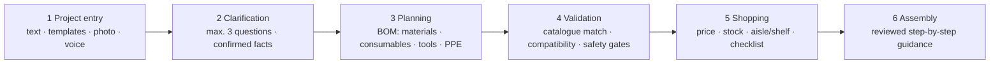

# Baumarkt-Buddy – Concept (Konzept)

| | |
|---|---|
| **Document** | `docs/01-concept.md` |
| **V-model phase** | 1 – Concept |
| **Version** | 0.1 (draft for team review) |
| **Date** | 23 October 2026 |
| **Source** | [`requirements/baumarkt-buddy-product-requirements.md`](../requirements/baumarkt-buddy-product-requirements.md) v1.0 |
| **Owner / approver** | Project lead & Product Owner · reviewed by Quality & Responsible AI |
| **Next document** | `docs/02-requirements.md` (Phase 1 scope – **not yet decided**) · [`docs/03-design.md`](03-design.md) |

> This concept is **scope-neutral**: it describes the product, the problem and the boundaries. The specific requirements for the first development phase are still to be selected by the team (see section 9).

---

## 1. Development process – V-model overview

We build Baumarkt-Buddy following the **V-model**. Each phase on the left side (define) has a matching phase on the right side (verify).

```text
 1 Concept ─────────────────────────────────────────▶ 7 Validation & operation
     ╲   (vision, users, KPIs)          (user tests, KPI review, pitch)   ╱
   2 Requirements ─────────────────────────────▶ 6 System test / V&V
       ╲   (FR, SR, NFR + acceptance)     (test cases, release-blocking)  ╱
     3 Design ─────────────────────────────▶ 5 Integration & unit tests
         ╲   (architecture, rules, data)   (agent pipeline, rule engine) ╱
                         4 Implementation (app/)
```

| # | Phase | Key question | Main product (in the repo) | Verified by |
|---|---|---|---|---|
| 1 | **Concept** | Why, for whom, what not? | `docs/01-concept.md` (this file) | Phase 7 |
| 2 | **Requirements** | What must the system do, and how do we prove it? | `requirements/…`, `docs/02-requirements.md` (Phase 1 subset), `test/01_test_cases.md` | Phase 6 |
| 3 | **Design** | How is it built? | `docs/03-design.md`, `diagrams/` | Phase 5 |
| 4 | **Implementation** | Build it | `app/`, prompts, rule-engine code | Code review |
| 5 | **Integration & unit test** | Do components work as designed? | `test/results/` | – |
| 6 | **System test / V&V** | Does the system meet each requirement? | V&V report, traceability matrix | – |
| 7 | **Validation & operation** | Does it solve the user's problem? | User-test report, KPI review, pitch | – |

**Phase gates:** each phase ends with a human review (pull request approval) before the next phase starts.

---

## 2. Problem statement (Problemstellung)

DIY-store customers planning a small home project face four recurring problems:

| # | Problem | Consequence |
|---|---|---|
| P1 | **Incompatible parts** – wrong plug, screw, drill bit or bracket for the wall and load | Failed or unsafe installation, returns |
| P2 | **Unnecessary spending** – buying tools or materials they already own | Higher cost, frustration |
| P3 | **Lost time in the store** – not knowing where products are | Long store visits, staff interruptions |
| P4 | **Repeat trips** – forgetting consumables, PPE or a matching part | Second trip, abandoned project |

Behind all four: customers lack product vocabulary and cannot judge **which facts matter** (wall type, load, dimensions) before buying.

---

## 3. Product vision (Produktvision)

> **Baumarkt-Buddy turns a home-improvement goal into a reviewed, compatible shopping plan with in-store locations – and stops when it is not safe to continue.**

**Elevator pitch:** A mobile web app, used without an account, in which the customer describes a project (e.g. *"hang a 20 kg shelf"*), answers a few focused questions, and receives a structured list of materials, consumables, tools and PPE – all from the store's catalogue, checked for compatibility, with price, stock and aisle/shelf.

**Core principle:** *The AI proposes – deterministic code decides.*

---

## 4. Users and stakeholders (Nutzer und Stakeholder)

| Group | Need | Priority |
|---|---|---|
| DIY beginner / renter | Clear plan without product vocabulary; help with missing facts | Primary |
| Occasional DIY homeowner | Compatibility and quantity checks; reuse of owned items | Primary |
| Multilingual shopper (DE/EN) | German and English, metric units, EUR | Primary |
| Experienced DIYer | Fast product and store discovery | Secondary |
| Store associate | Explainable project summary for advice | Later |
| **Store operator (B2B customer)** | Higher basket completeness, fewer returns, less staff time | Business customer |
| Project team / lecturers | Working MVP, documented process, pitch | Internal |

---

## 5. Reference use cases (Referenz-Anwendungsfälle)

| ID | Use case | Why it matters |
|---|---|---|
| UC-1 | **Hang a 20 kg shelf on a wall** | Main demo; tests wall type, load, plug–screw–bit compatibility, safety gate |
| UC-2 | **Assemble a freestanding shelf / furniture** | Low-risk entry project; no wall fixing |
| UC-3 | **Hang a picture or mirror** | Simple mounting with low load |
| UC-4 | **Paint a room** | Non-mounting project; consumables and PPE |
| UC-5 | **High-risk request** (e.g. "replace my ceiling light") | Must be refused with "hire a professional" |

Which use cases are implemented in the first phase is a **scope decision** (section 9).

---

## 6. Product capabilities (Produktfähigkeiten)

The full product, as described in the requirements v1.0, covers six capability areas. Each later receives FR/SR/NFR IDs.



---

## 7. Scope and boundaries (Abgrenzung)

### 7.1 In scope (product)

- Indoor shelf, furniture, small mounting, painting and small repair projects.
- Mobile-first web app / PWA, no mandatory login.
- One pilot store or a clearly fictional store with **labelled mock data**.
- German UI with English option; metric units; EUR.

### 7.2 Hard exclusions (never supported)

- Mains electrical, gas, load-bearing walls, concealed plumbing, roof work and other high-risk trades → refusal plus professional hand-off.
- Payment, automatic checkout, autonomous reservation.
- Guaranteed wall identification, drilling clearance or exact measurements from photos.
- Indoor blue-dot navigation, precise AR, native iOS/Android apps.

### 7.3 Product principles (apply to every later requirement)

| # | Principle |
|---|---|
| 1 | **Deterministic before model** – quantities, compatibility, totals and safety gates are code. |
| 2 | **Catalogue is the only product source** – no invented products, SKUs or prices. |
| 3 | **Unknown is a valid value** – missing facts are never estimated. |
| 4 | **Safety beats convenience** – missing evidence stops the flow. |
| 5 | **Confirm before use** – anything the app *understood* is confirmed by the user first. |
| 6 | **Transparent AI** – AI guidance is labelled; mock data is labelled "mock". |

---

## 8. Constraints and assumptions (Rahmenbedingungen)

| Type | Constraint / assumption |
|---|---|
| Time | 2-week MVP sprint from 19 Oct 2026 → final pitch |
| Data | Sample catalogue and store map (70 products) in `data/`; invented prices and aisles |
| Build | Hybrid: vibe coding + AI agents + human review |
| Legal | GDPR, EU AI Act transparency; no live retailer API or data licence |
| Team | 5 roles: Lead/PO, App builder, Data & research, Quality & responsible AI, Business & design |
| Assumption | A DIY store would pilot the app if it improves basket completeness and reduces staff time |

---

## 9. Phases of product development and open scope decision

The requirements v1.0 describes a product larger than one MVP. We deliver it in increments.

| Increment | Goal | Status |
|---|---|---|
| **Phase 1 – MVP / prototype** | One end-to-end safe flow (enter → clarify → BOM → validate → shop list) | **Scope to be decided** |
| Phase 2 – Extended MVP | More templates, alternatives, checklist, assembly steps | Later |
| Phase 3 – Pilot | Real store data, store associate hand-off, barcode scan | Later |
| Phase 4 – Expansion | More retailers, voice/visualisation, native app | Later |

**Decisions needed before `docs/02-requirements.md` is written:**

| # | Decision | Options |
|---|---|---|
| D-1 | Which entry modes in Phase 1? | Text only · Text + templates · + voice · + photo |
| D-2 | Which use cases / templates? | UC-1 only · UC-1 + UC-3 · UC-1…UC-4 |
| D-3 | Which capability areas end-to-end? | 1–4 only · 1–5 · 1–6 |
| D-4 | UI language default | German default + English toggle · English only for demo |
| D-5 | Prioritisation method | MoSCoW · P0/P1/P2 |

---

## 10. Success criteria (Erfolgskriterien)

| KPI | Target (proposed) | Checked in |
|---|---|---|
| Hallucinated products | **0 %** | Phase 6 – V&V |
| High-risk requests refused with hand-off | **100 %** | Phase 6 – red-team |
| Unknown wall type / load blocks mounting advice | **100 %** | Phase 6 – release-blocking |
| Shopping list generated | **< 5 s** | Phase 6 – performance |
| Basic flow completed by test users without help | **≥ 4 of 5** in < 2 min | Phase 7 – user test |
| Mock data / AI output labelled | **100 %** | Phase 6 – UI check |

---

## 11. Risks (Risiken)

| Risk | Mitigation |
|---|---|
| AI suggests products not in the catalogue | Catalogue check in code; output blocked otherwise |
| Safety rules end up in prompts instead of code | Code review; design rule in `03-design.md` |
| Scope too large for 2 weeks | Explicit Phase 1 scope decision (section 9) |
| Market already has retailer apps with store finder | Differentiate on compatibility checks, explicit uncertainty and safety stops |
| AI service down during demo | Template fallback + recorded demo video |

---

## 12. Concept phase exit criteria (Phasenabschluss)

- [ ] Vision, users, use cases and exclusions agreed by the team
- [ ] KPIs accepted as the basis for validation (Phase 7)
- [ ] Decisions D-1 … D-5 taken → start `docs/02-requirements.md`
- [ ] Concept approved via pull request by Project lead and Quality
