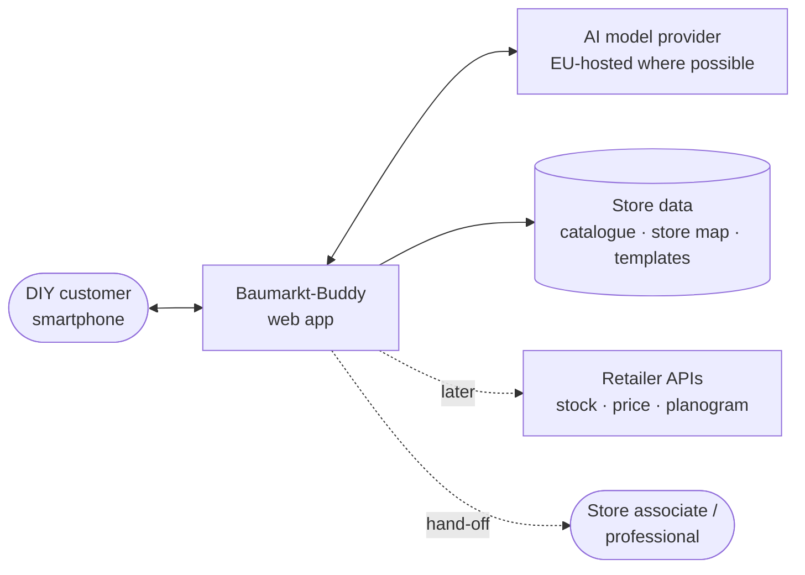
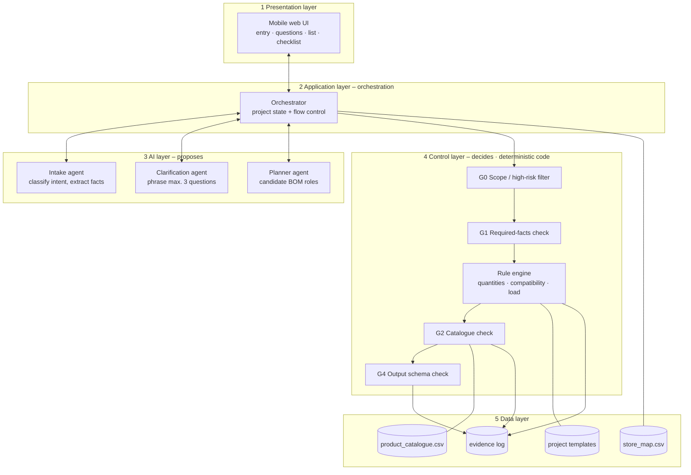
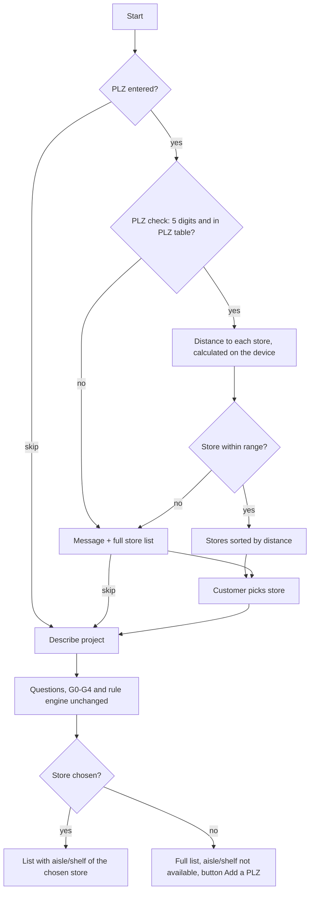
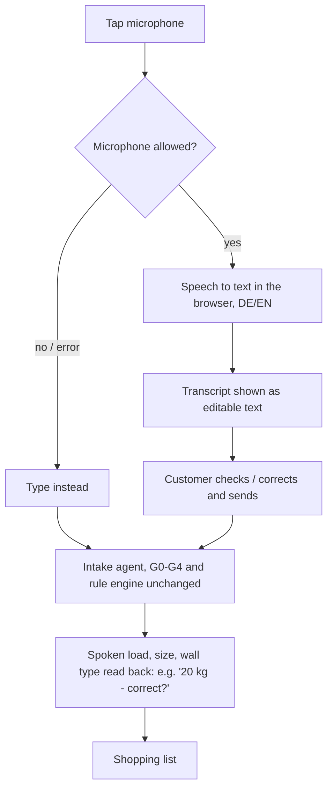
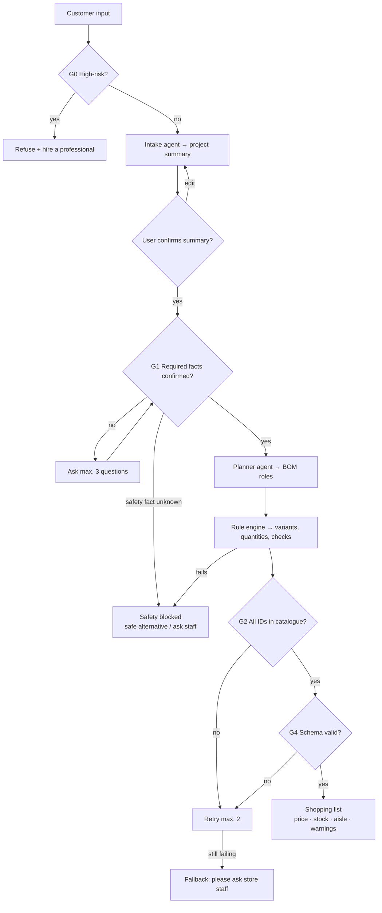
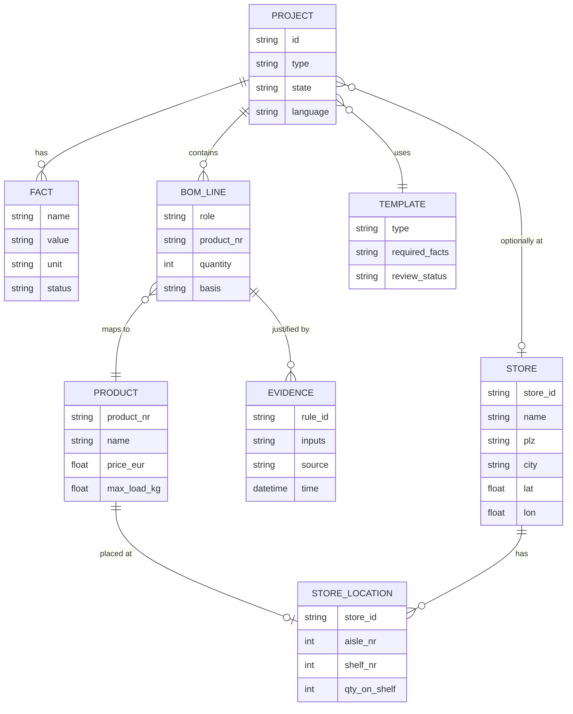

# Baumarkt-Buddy – Design & Architecture (Entwurf & Architektur)

| | |
|---|---|
| **Document** | `docs/03-design.md` |
| **V-model phase** | 3 – Design |
| **Version** | 0.4 (one data workbook, 5 OBI stores, availability referral) |
| **Date** | 25 October 2026 |
| **Inputs** | [`docs/01-concept.md`](01-concept.md) · [`requirements/baumarkt-buddy-product-requirements.md`](../requirements/baumarkt-buddy-product-requirements.md) v1.0 · [`diagrams/`](../diagrams/) |
| **Owner / approver** | App builder · reviewed by Quality & Responsible AI |
| **Verified by** | Phase 5 – integration and unit tests (`test/`) |

> This design covers the **full target architecture**. Section 11 marks which building blocks are needed for which increment. Once the Phase 1 requirements are fixed, each component gets the requirement IDs it implements.

---

## 1. Purpose of the design phase

The design phase answers **how** the system is built so that every requirement can be met and tested.

| Design product | Section | Tested in Phase 5 by |
|---|---|---|
| System architecture (layers and components) | 3–4 | Integration tests |
| Processing pipeline and safety gates | 5 | Integration + red-team tests |
| Rule engine (deterministic logic) | 6 | Unit tests (UT-xx) |
| Data model and data sources | 7 | Data validation tests |
| Interfaces: AI prompt and JSON contracts | 8 | Schema / contract tests |
| Project state model | 9 | State-transition tests |

---

## 2. Design principles (Entwurfsprinzipien)

| # | Principle | Design consequence |
|---|---|---|
| DP-1 | **The AI proposes – code decides** | AI only classifies, extracts and phrases questions. Quantities, compatibility, totals and safety are code. |
| DP-2 | **Closed product world** | The AI may only return product IDs; IDs are checked against the catalogue. Names and prices come from the catalogue, never from the model. |
| DP-3 | **Fail safe** | Any missing fact, failed check or service error leads to a stop state – never to a guess. |
| DP-4 | **Rules in code, not in prompts** | Limits (e.g. kg values, safety factors) live in the rule engine / config, never in prompt text. |
| DP-5 | **Data separate from code** | Catalogue, store map and templates are CSV/JSON files, replaceable by APIs later. |
| DP-6 | **Untrusted input** | User text, transcripts, photos and product data are data, never instructions. |
| DP-7 | **Evidence for every decision** | Each check stores rule, inputs, source and time (evidence record). |

---

## 3. System context (Systemkontext)



| External actor | Interaction | Boundary rule |
|---|---|---|
| Customer | Text or voice, answers, (later) photo; receives list | No login; minimal personal data; audio not stored |
| AI model provider | Receives minimal context; returns JSON | Output always schema-validated |
| Store data | Read-only lookups | Mock data labelled "mock" |
| Retailer APIs | Later increment | Not in prototype |

---

## 4. Architecture – layers and components (Architektur)



### 4.1 Component responsibilities

| Component | Type | Responsibility | Must NOT do |
|---|---|---|---|
| **Mobile web UI** | Code | Entry, show summary, ask questions, show BOM, price, stock, aisle; AI notice | Show anything not validated |
| **Orchestrator** | Code | Controls flow and project state; calls agents and gates in order | Skip a gate |
| **Intake agent** | AI | Classify project type; extract load, dimensions, wall type as *candidate* facts | Decide products or safety |
| **Clarification agent** | AI | Turn missing facts into user-friendly questions (DE/EN) | Decide which facts are required (template does) |
| **Planner agent** | AI | Propose BOM roles (board, bracket, plug, screw, tools, PPE) | Return product names or prices |
| **G0 Scope filter** | Code | Detect high-risk work → refuse + hand-off | Be overridden by AI text |
| **G1 Facts check** | Code | Required facts per template confirmed? Otherwise ask / block | Accept unconfirmed facts |
| **Rule engine** | Code | Select variants, compute quantities, check compatibility and load | Add nominal anchor ratings |
| **G2 Catalogue check** | Code | Every product ID exists in the catalogue | Accept unknown IDs |
| **G4 Output check** | Code | JSON schema valid; else retry (max. 2) → fallback | Pass invalid output |
| **Data layer** | Files | Catalogue, store map, templates, evidence log | Contain logic |
| **Store selection (PLZ)** | UI + Code | Optional PLZ, validate, sort stores by distance on the device | Send the PLZ to the AI or server; block the flow when skipped |
| **Speech input** | UI | Speech to editable text in the browser; customer confirms before use | Store audio; use spoken values without confirmation |

### 4.2 Store selection by PLZ (added in v0.2 – FR-29 Should, FR-30 Must)

The customer may enter a postcode (PLZ) at the start to pick a nearby sample store. Skipping is always possible: product choice, compatibility and safety checks are identical; only aisle and shelf are missing.



| # | Design element | Layer | Component |
|---|---|---|---|
| D-1 | Store selection screen: PLZ field, store list (name, city, km), "skip", "no store near you" message | L1 | DC-12 (moved from R3 to R1, PLZ only) |
| D-2 | List screen: state "no store selected" + "Add a PLZ" button | L1 | DC-04 |
| D-3 | Project state holds the chosen store (optional); store change → aisle/shelf looked up again | L2 | DC-13, DC-14 |
| D-4 | PLZ validator + distance calculation (straight-line km) and sorting – deterministic code, runs in the browser | L4 | **DC-43 (new)** |
| D-5 | PLZ reference table (PLZ → coordinates, open data); Stores sheet in the single data file | L5 | **DC-42 (new)**, DC-31 |
| D-6 | Stock and aisle/shelf keyed by store ID | L5 | DC-31, DC-35 |
| D-7 | Data model: entity STORE; PROJECT → STORE (0..1) | §7.2 | – |
| D-8 | Output: `store_id`, `store_status`; aisle/shelf empty without a store | §8 | – |
| D-9 | Privacy: the PLZ never leaves the device, is not sent to the AI and is not logged | Cross-cutting | DC-37 |
| D-10 | Unit tests: validator, distance sorting; RB-15, RB-16, RB-17 | §12 | – |
| D-11 | Nearest store preselected automatically and shown with "change" (FR-29) | L1, L4 | DC-12, DC-43 |
| D-12 | Availability referral: item with qty 0 or no aisle in the selected store stays on the list, marked; nearest other store with qty > 0 is named, else "please ask staff"; never removed or substituted (FR-31) | L4, L1 | DC-43, DC-35, DC-04 |

**AI layer (L3): no change.** The AI never receives the PLZ or the store.

### 4.3 Speech input (added in v0.3 – FR-25, FR-27, SR-11 Must in R1)

The customer can describe the project by voice instead of typing. Speech is turned into text in the browser; from then on it is exactly the same flow as typed input. Typing always remains available.



| # | Design element | Layer | Component |
|---|---|---|---|
| S-1 | Microphone button, recording indicator, editable transcript box | L1 | DC-10 (moved from R3 to R1) |
| S-2 | Read-back of spoken safety values (load, size, wall type) – reuses the fact confirmation view | L1 | DC-02 |
| S-3 | Transcript passed into the same flow; microphone error → fall back to typing | L2 | DC-13 |
| S-4 | Facts from speech get status `observed` until the customer confirms them | L4 | DC-23 |
| S-5 | Spoken instructions treated as data (prompt-injection guard) | L4 | DC-27 |
| S-6 | Privacy: microphone only with permission; audio not stored; speech service named in the privacy notice | Cross-cutting | DC-37 |
| S-7 | Tests: RB-18 (misheard value confirmed), RB-19 (microphone denied → typing works), RB-20 (high-risk by voice refused) | §12 | – |

**AI layer (L3): no change.** The intake agent receives text, as before.

---

## 5. Processing pipeline and safety gates (Verarbeitungskette)



| Gate | Check | Failure result |
|---|---|---|
| **G0** | High-risk keywords / intents (electrical, gas, load-bearing, plumbing, roof) | Refusal + hand-off banner, no BOM |
| **G1** | Template's required facts (e.g. wall type, load) are user-confirmed | Question or *Safety blocked* |
| **G3 / Rule engine** | Compatibility, load limits, quantities | Item blocked with reason / alternative |
| **G2** | Product IDs exist in catalogue | Retry → fallback |
| **G4** | Output JSON matches schema | Retry → fallback |

---

## 6. Rule engine (Regelwerk) – deterministic logic

All values below are **mock values for the prototype** and must be confirmed by a reviewer before any public use.

| ID | Rule | Purpose |
|---|---|---|
| R-01 | No mounting output unless wall type and load are confirmed | Safety |
| R-02 | Select smallest bracket with rated load ≥ 1.25 × intended load | Compatibility |
| R-03 | Select board whose rated load ≥ 1.25 × intended load | Compatibility |
| R-04 | Wall plug must be in the bracket's `compatible_with` list and suit the wall type | Compatibility |
| R-05 | Drill bit derived from the plug diameter | Compatibility |
| R-06 | Screw derived from the plug (diameter and length) | Compatibility |
| R-07 | Capacity from system / manufacturer rating, **not** the sum of plug ratings; no rating → *Data unavailable* | Safety |
| R-08 | Plasterboard and load > 25 kg → *Safety blocked*, offer alternative | Safety |
| R-09 | Drill type by wall (concrete/brick → hammer drill) | Tools |
| R-10 | PPE by activity (drilling → safety glasses, dust mask) | PPE |
| R-11 | Any drilling → detector + warning "a negative scan is no guarantee" | Safety |
| R-12 | Any load > 50 kg → *Safety blocked* + professional | Safety |
| R-13 | Product with `requires_professional = yes` → refuse | Safety |
| R-14 | Quantities per bracket pair (plugs and screws per bracket) | Quantity |
| R-15 | Picture-hook rule by weight and wall type | Quantity |
| R-16 | Required item missing in catalogue → flag, never substitute silently | Data |

**Example – UC-1 "hang a 20 kg shelf on concrete":** R-01 ✓ → R-02/R-03 bracket and board ≥ 25 kg → R-04…R-06 plug, bit, screw → R-09 hammer drill → R-10 PPE → R-11 detector + warning → R-14 quantities.

---

## 7. Data model and sources (Datenmodell)

### 7.1 Data sources (prototype)

| File | Content | Key fields |
|---|---|---|
| `data/product_catalogue.xlsx` – sheet **Products** (export `data/products.csv`) | 70 products, written once for all stores (DR-01) | `product_nr`, `product_name`, `category`, `size`, `price_eur`, `max_load_kg`, `suitable_wall_types`, `compatible_with`, `requires_professional`, `safety_note` |
| `data/product_catalogue.xlsx` – sheet **Store stock** (export `data/store_stock.csv`) | Aisle, shelf and quantity per product for each store (DR-01) | `product_nr`, then per store `<store_id>_aisle_nr`, `_aisle_name`, `_shelf_nr`, `_qty` · empty aisle = not carried · qty 0 = out of stock |
| `data/product_catalogue.xlsx` – sheet **Stores** (export `data/stores.csv`) | 5 sample OBI stores: NUE-LEY, NUE-REG, NUE-BAY, ERL-OST, ERL-WEST (fictional partnership for the exam) | `store_id`, `store_name`, `street`, `plz`, `city`, `opening_hours`, `lat`, `lon` |
| `data/product_catalogue.csv`, `data/store_map.csv` | **Obsolete** since v0.4 – kept for reference only | – |
| `data/templates/*.json` *(to be created)* | Project templates | `project_type`, `required_facts`, `questions`, `bom_roles`, `quantity_rules`, `review_status` |
| `data/plz_coordinates.csv` (DR-08) | German PLZ → centre coordinates (8,298 PLZ) | `plz`, `lat`, `lon` · source: plz_geocoord, WZB Berlin 2019, Apache-2.0 · store coordinates = PLZ centre (approximate) |

### 7.2 Core entities



**Fact status values:** `observed` (from text/speech/photo) · `user-confirmed` · `manufacturer-supported` · `unknown`. Only `user-confirmed` or `manufacturer-supported` facts may drive safety decisions.

---

## 8. Interfaces – AI contracts (Schnittstellen)

The AI never returns free text to the UI. Each agent returns JSON that is validated (G4).

**Intake agent → Orchestrator**

```json
{
  "project_type": "hang_shelf",
  "high_risk": false,
  "facts": [
    { "name": "load_kg", "value": 20, "status": "observed" },
    { "name": "wall_type", "value": null, "status": "unknown" }
  ],
  "language": "en"
}
```

**Planner agent → Rule engine**

```json
{
  "project_type": "hang_shelf",
  "bom_roles": ["board", "bracket", "wall_plug", "screw", "drill", "drill_bit", "detector", "safety_glasses"]
}
```

**Rule engine → UI (validated output)**

```json
{
  "state": "products_validated",
  "store_id": "S01",
  "store_status": "selected",
  "lines": [
    { "role": "bracket", "product_nr": "P0xx", "quantity": 2, "basis": "R-02, R-14",
      "price_eur": 0.0, "aisle_nr": 0, "shelf_nr": 0, "data_label": "mock" }
  ],
  "warnings": ["A negative scan does not guarantee the wall is free of cables or pipes"],
  "ai_notice": true
}
```

| Contract rule | |
|---|---|
| Unknown fields or unknown `product_nr` | Rejected (G2/G4) |
| Invalid JSON | Retry max. 2, then fallback |
| Prompts | Contain role and format only – **no limits or safety values** (DP-4) |

---

## 9. Project state model (Zustandsmodell)

```mermaid
stateDiagram-v2
  [*] --> Draft
  Draft --> NeedsClarification: facts missing
  Draft --> SpecConfirmed: summary confirmed, facts complete
  NeedsClarification --> SpecConfirmed: answers confirmed
  NeedsClarification --> SafetyBlocked: safety fact unknown
  SpecConfirmed --> BOMReviewed
  BOMReviewed --> ProductsValidated: all gates pass
  BOMReviewed --> SafetyBlocked: rule fails
  BOMReviewed --> DataUnavailable: source / rating missing
  ProductsValidated --> ShoppingPlanApproved
  ShoppingPlanApproved --> Acquiring --> ReadyForAssembly --> Completed
  Draft --> ProfessionalReview: high-risk (G0)
  SafetyBlocked --> NeedsClarification: user adds facts
  ProductsValidated --> BOMReviewed: input changed (revalidate)
```

Rule: a failed service call never advances a state; any change to material, dimension, load or product returns the project to *BOM reviewed* for revalidation.

---

## 10. Technology options (Technologie)

| Layer | Prototype option | Later option |
|---|---|---|
| UI | Static HTML/CSS/JS (current `app/`) or Lovable (React) | PWA with offline checklist |
| Orchestrator + rule engine | JavaScript/TypeScript module or edge function | Backend service with tests in CI |
| AI model | Commercial LLM via API (JSON mode) | EU-hosted model, retrieval over approved sources |
| Data | CSV / JSON in repo | Retailer PIM / stock APIs |
| Tests | Script-based unit tests + manual system tests | Automated CI pipeline |

**Decision open:** UI path (current static app vs. Lovable) – to be decided together with the Phase 1 scope.

---

## 11. Building blocks per increment

| Building block | Phase 1 MVP (candidate) | Phase 2 | Phase 3+ |
|---|---|---|---|
| Text entry + Intake agent | ● | ● | ● |
| Project templates (choose) | ● | ● | ● |
| G0–G4 gates + rule engine (R-01…R-16) | ● | ● | ● |
| Clarification (max. 3 questions) | ● | ● | ● |
| BOM + catalogue match + aisle/shelf | ● | ● | ● |
| Optional PLZ store selection (on device) | ● | ● | ● |
| Device location (GPS) / store QR code | – | – | ○ |
| Voice entry (speech to text) | ● | ● | ● |
| Photo entry (candidate detection only) | – | ○ | ● |
| Alternatives, offline checklist, export | – | ● | ● |
| Assembly guidance | – | ○ | ● |
| Retailer APIs, barcode scan, associate hand-off | – | – | ● |

● planned · ○ optional · – not included. **Final Phase 1 selection follows the team decision in `01-concept.md` §9.**

---

## 12. Traceability: design → test (Rückverfolgbarkeit)

| Design element | Test level (Phase 5/6) | Example |
|---|---|---|
| Rule engine R-01…R-16 | Unit tests UT-xx | R-08: plasterboard + 30 kg → blocked |
| Gates G0–G4 | Integration tests | Unknown product ID → retry → fallback |
| AI contracts (section 8) | Contract / schema tests | Invalid JSON never reaches UI |
| State model (section 9) | State-transition tests | Load change invalidates validated BOM |
| End-to-end pipeline | System tests / exit tests T1–T5 | UC-1 full list with aisle and shelf |
| Store selection (§4.2) | Unit + release-blocking tests | Invalid PLZ selects no store (RB-16); skipped PLZ gives full list (RB-17); only the selected store's aisle/shelf (RB-15) |
| Availability referral (§4.2, D-12) | Release-blocking + system tests | Missing part never removed (RB-21); referral to nearest store with stock (TC-34 to TC-37) |
| Speech input (§4.3) | Release-blocking + UI tests | Misheard value confirmed (RB-18); microphone denied → typing (RB-19); high-risk by voice refused (RB-20) |

---

## 13. Open design decisions

| # | Decision | Proposal |
|---|---|---|
| DD-1 | UI implementation path | Decide with Phase 1 scope |
| DD-2 | R-07 capacity source without a manufacturer system rating | Show *Data unavailable*; reviewer to confirm |
| DD-3 | Safety factors and limits (1.25×, 25 kg, 50 kg) | Keep as mock values; reviewer to confirm |
| DD-4 | Where the orchestrator runs (browser vs. backend) | Backend/edge, to keep API keys and rules off the client |
| DD-5 | Speech-to-text service | Browser Web Speech API (in R1). Not available in Firefox → typing; audio may be processed by the browser vendor → named in the privacy notice |
| DD-6 | Distance for "no store near you" and max. stores shown | TBD (team) |
| DD-7 | Number of sample stores | **Decided:** 5 OBI stores in Nürnberg and Erlangen (sample data) |
| DD-8 | Stock and price display without a store | TBD (team) |
| DD-9 | PLZ data source and licence | **Decided:** plz_geocoord (WZB Berlin, Apache-2.0) → `data/plz_coordinates.csv` |

---

## 14. Design phase exit criteria (Phasenabschluss)

- [ ] Architecture and component responsibilities reviewed
- [ ] Rule table and limits reviewed by Quality (mock values marked)
- [ ] AI JSON contracts agreed
- [ ] Each Phase 1 requirement mapped to at least one component and one test
- [ ] Design approved via pull request by App builder and Quality
