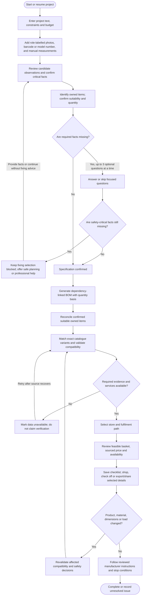
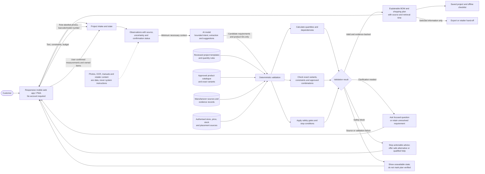
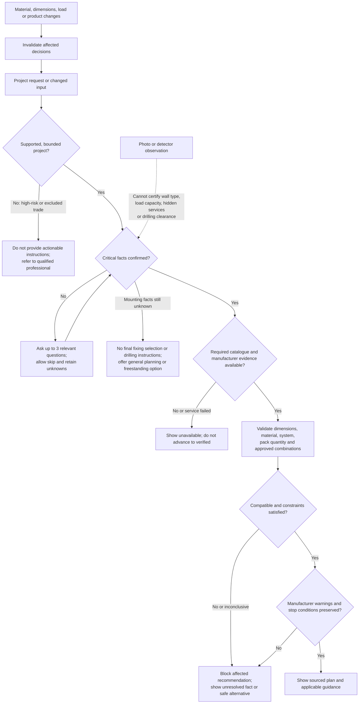
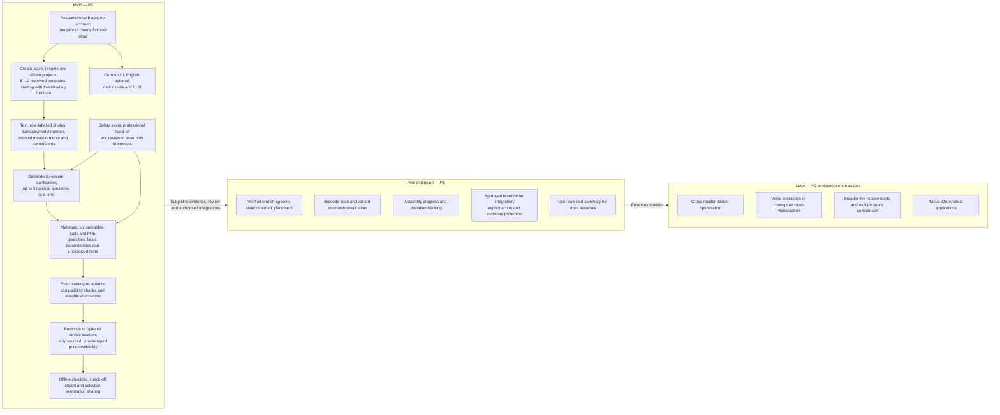

# Baumarkt Buddy diagrams

These diagrams summarize the product workflow, validation boundaries and release scope in the [product requirements](../requirements/baumarkt-buddy-product-requirements.md). The MVP is a mobile-first prototype using mock data where authorised live sources are not available; mock values must be labelled, and unverified availability or store placement must not be presented as fact.

## Customer journey and project lifecycle

The project can also be saved, resumed or deleted. Saved checklists remain readable offline; stock and other time-sensitive claims must be marked stale or unavailable when they cannot be verified.

## Prototype architecture and evidence boundary

The model can suggest intent, requirements and catalogue identifiers, but cannot invent product names, variants, SKUs, prices or evidence. Deterministic code and approved sources govern quantities, compatibility, totals, safety gates and external actions. Every displayed exact variant, price, availability claim or store placement needs its applicable source and retrieval time; mock data must be identified as mock.

## Safety and validation decisions

Unknown or inconclusive evidence is a stop, not permission to proceed. A detector's negative result is not clearance to drill; shelf capacity must not be derived by adding nominal anchor ratings. Manufacturer warnings cannot be weakened by generated text, and qualified reviewers must approve mounting templates and release-blocking safety tests.

## MVP boundary and release priorities

Payment, automatic checkout, autonomous reservation, unapproved substitutions, guaranteed real-time retailer data, structural engineering, high-risk trades, precise AR installation and indoor blue-dot navigation are not MVP capabilities. Store placement is shown only when verified for the selected branch and map revision; otherwise use an honest fallback.
