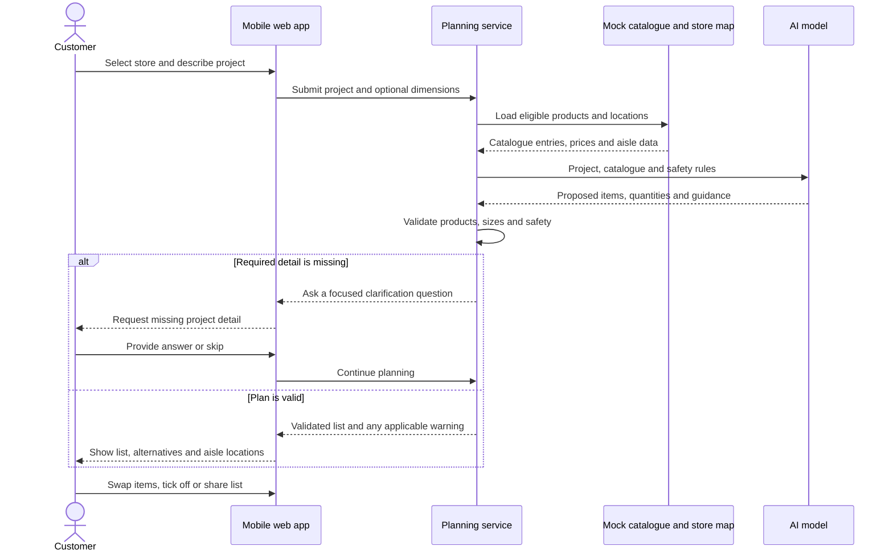
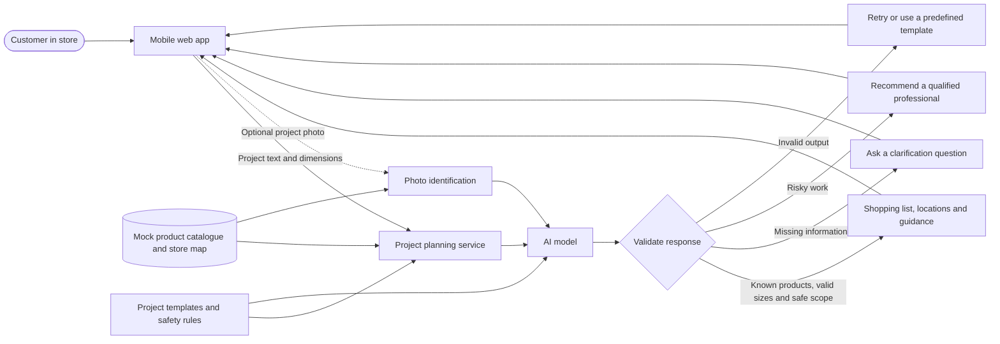
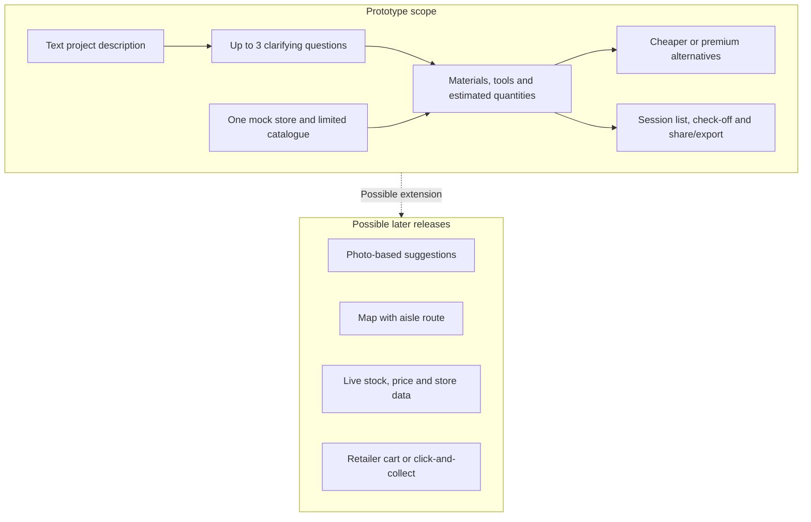

# Baumarkt-Buddy diagrams

These diagrams summarize the product flow and prototype architecture described in the [requirements specification](../docs/requirements-specification.md). The prototype uses mock catalogue and store data; it is not connected to a retailer's live systems.

## Customer journey

## Prototype architecture and safety boundary

The model may propose catalogue product identifiers, but the application must resolve them against the catalogue and display catalogue-sourced names and prices. Electrical, gas and load-bearing work must trigger a professional referral rather than step-by-step instructions. Invalid model output must not be shown as a completed plan.

## MVP boundary

The requirements identify photo suggestions and routed store maps as could-have features. Live stock, checkout, accounts and multiple stores are out of scope for the MVP. The current sample data and aisle positions are fictional.
