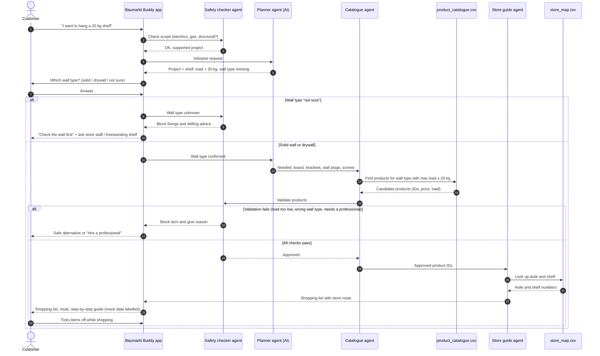

## Sequence diagram: "Hang a 20 kg shelf"

Use case: a DIY beginner wants to hang a shelf. The app asks for the wall type, checks safety, matches products only from our catalogue and shows where to find them in the store.

**Key rule:** The AI only interprets the request. Products, loads and safety decisions always come from the catalogue and the safety checker. If anything is unknown, the app stops rather than guessing.
