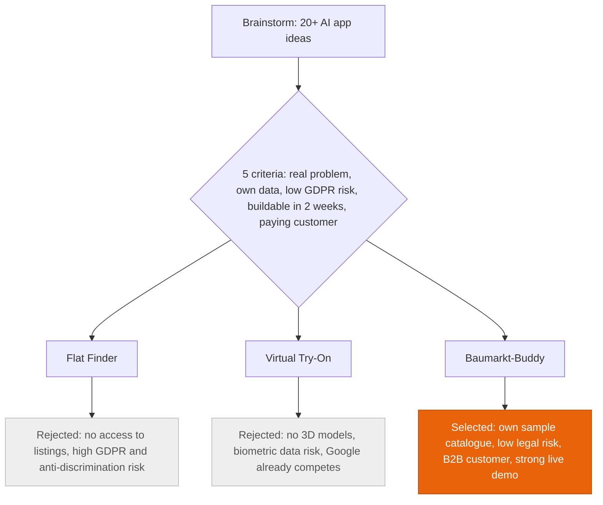
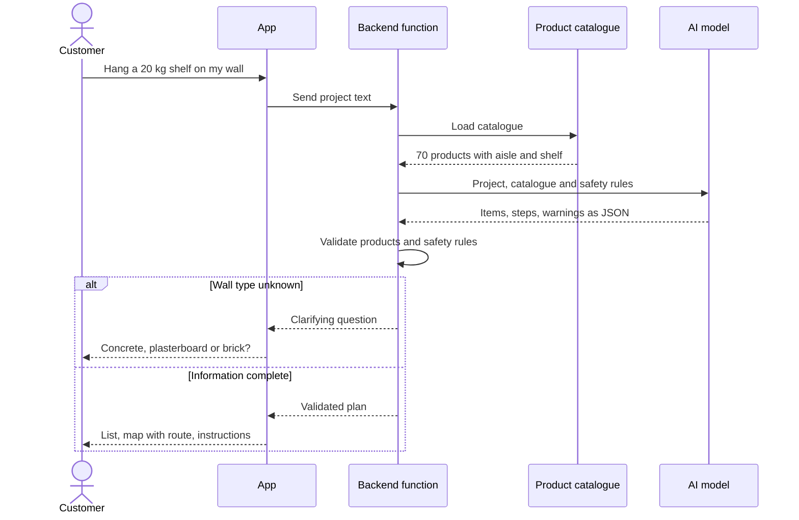
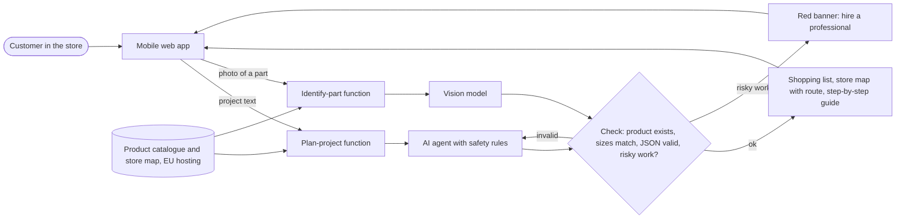
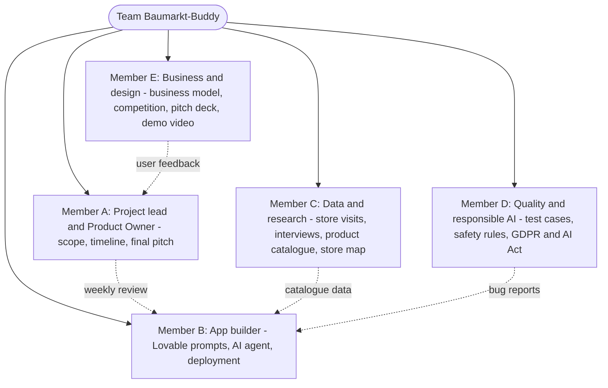
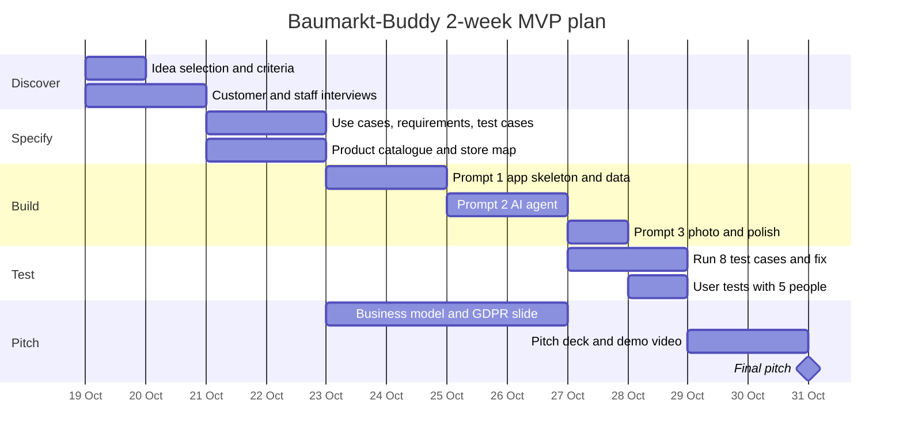
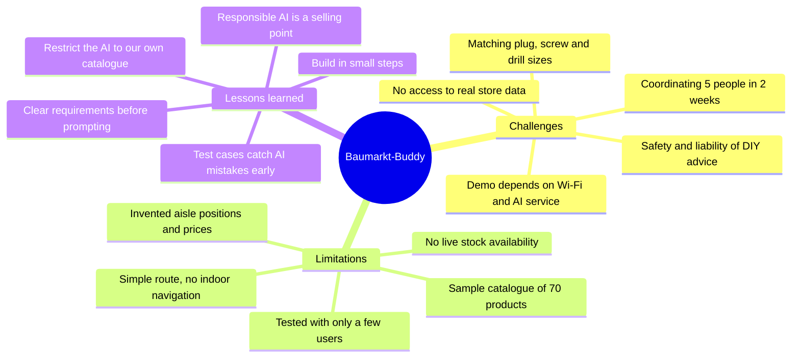

# DIY Project Finder – Requirements Specification > CHANGE TEST can you see?

Oct 17, 2026 · @Patrik Saile

## 1. Purpose and problem statement

The DIY Project Finder turns a planned home-improvement project into a complete shopping list with in-store locations, in under a minute.

Today, DIY customers often arrive at the hardware store unsure what they need. They forget items, buy the wrong quantities, or spend time searching aisles and waiting for staff. This leads to repeat trips, returns and lost sales for the store.

**Product vision:** From "I want to build a raised garden bed" to "here is everything you need, how much of it, and where it is in this store".

**Why this idea:** we screened 20+ AI app ideas against five criteria and chose the DIY Project Finder over the Flat Finder and Virtual Try-On.

## 2. Target users and personas

The prototype targets the DIY beginner first; the other two personas shape later releases.

| Persona | Profile | Main need | Priority |
| --- | --- | --- | --- |
| DIY beginner | First own home or garden, little tool experience | Guidance and a complete list so nothing is forgotten | Primary (MVP) |
| Experienced DIYer | Knows what to do, values time | Find products and locations fast, compare alternatives | Secondary |
| Store employee | Advises customers at the counter or in the aisle | Build a project list together with the customer | Later release |

## 3. Functional requirements

Six must-have user stories form the MVP; three could-haves follow if time allows. Priorities use MoSCoW.

| ID | User story | Acceptance criteria | Priority |
| --- | --- | --- | --- |
| FR-01 | As a user, I describe my project in free text so I don't need to know product names. | AI identifies the project type (e.g. "raised bed", "tile bathroom wall") for at least 8 of 10 test prompts. | Must |
| FR-02 | As a user, I answer a few follow-up questions so the list fits my project. | Max. 3 questions (e.g. dimensions, indoor/outdoor, material); user can skip any question. | Must |
| FR-03 | As a user, I get a complete material and tool list with quantities. | List splits into materials, tools, consumables; quantities derive from entered dimensions; generated in under 5 seconds. | Must |
| FR-04 | As a user, I see price, availability and aisle/shelf for each product in my store. | Each list item maps to a catalogue product with price, stock flag and aisle number. | Must |
| FR-05 | As a user, I can swap a product for a cheaper or premium alternative. | At least one alternative shown where the catalogue has one; total price updates instantly. | Must |
| FR-06 | As a user, I can save, tick off and share my list. | List persists in the session; items can be checked off; share via link or export. | Must |
| FR-07 | As a user, I get step-by-step instructions for my project. | 5–10 steps generated, each linked to the products it uses. | Could |
| FR-08 | As a user, I upload a photo and get suggestions on what I need. | Image is classified into a project type; flow continues at FR-02. | Could |
| FR-09 | As a user, I see a store map with the shortest route through my items. | Items ordered by aisle; simple map highlights stops. | Could |

**Core user flow:**

1. Choose store
2. Describe project
3. Answer follow-up questions
4. Review list, swap alternatives
5. Shop by aisle and tick off items

**Customer journey (example: hanging a 20 kg shelf):** the backend validates the AI's answer and asks a clarifying question when key information, such as the wall type, is missing.

## 4. Non-functional requirements

The app must work on a phone in the store aisle, without an account, and be transparent about AI-generated advice.

| ID | Category | Requirement |
| --- | --- | --- |
| NFR-01 | Usability | Mobile first; core flow completable in under 2 minutes without instructions. |
| NFR-02 | Performance | AI response in under 5 seconds; catalogue lookups under 1 second. |
| NFR-03 | Privacy | GDPR compliant; no mandatory login; no personal data sent to the LLM. |
| NFR-04 | Transparency | AI recommendations clearly labelled; quantities shown as estimates. |
| NFR-05 | Safety | Disclaimer and referral to a professional for electrical, gas and load-bearing work. |
| NFR-06 | Reliability | If the LLM fails, a fallback offers predefined project templates. |
| NFR-07 | Language | German UI for the target market; English optional. |
| NFR-08 | Maintainability | Catalogue data separate from code (JSON/CSV) so it can be swapped for a real API. |

## 5. Architecture, data and interfaces

The prototype runs on mock data and one LLM API; each source is designed to be replaced by a real system later.

**How the app works:** every AI answer passes a validation step before it reaches the customer; risky work triggers a "hire a professional" banner instead of instructions.

| Data / interface | Prototype | Production |
| --- | --- | --- |
| Product catalogue | Mock JSON/CSV, approx. 150–300 products across 5–10 project types | Retailer PIM / product API |
| Stock and price | Static values in the mock file | Merchandise management system (real-time stock) |
| Store layout | Aisle numbers per product, one store | Planogram data per store |
| Project templates | 5–10 hand-built templates (materials, quantity rules) | Curated library maintained by category managers |
| LLM | Commercial LLM API (e.g. Claude) for intent, questions and list generation | Same, with retrieval over the live catalogue |
| Sharing | Link or PDF export | Hand-off to online shop cart / click & collect |

**Key design rule:** the LLM only selects products that exist in the catalogue; it never invents product names or prices.

## 6. Scope

The MVP covers FR-01 to FR-06 for one store and a limited set of project types; everything transactional stays out.

**In scope (MVP)**

- One fictional store with mock catalogue and aisle data
- 5–10 project types (e.g. raised garden bed, wall shelf, painting a room, laying laminate, garden fence)
- Must-have user stories FR-01 to FR-06
- Clickable web app, usable on a phone

**Out of scope**

- Payment, checkout and real cart integration
- Real-time stock and live retailer data
- User accounts and login
- Multiple stores and store comparison
- Native iOS/Android apps

## 7. Success criteria and KPIs

The prototype succeeds if test users find it more helpful than searching alone; the KPIs below feed the business case. Target values are placeholders for the group to set.

| KPI | What it shows | Measured in prototype? | Target (to define) |
| --- | --- | --- | --- |
| List completeness | Share of needed items the app suggests | Yes, against expert lists | e.g. ≥ 90 % |
| Task completion time | Time from project idea to finished list | Yes, user test | e.g. < 2 min |
| User satisfaction | Perceived usefulness (SUS or 1–5 rating) | Yes, survey | e.g. SUS ≥ 70 |
| Average basket value | Upsell through complete lists and alternatives | No, business case assumption | e.g. +10 % |
| Advisory time per customer | Staff time saved | No, business case assumption | tbd |
| Return rate | Fewer wrong purchases | No, business case assumption | tbd |
| Repeat trips avoided | Customer convenience | No, survey estimate | tbd |

## 8. Vibe coding approach

This spec is the shared context for every AI coding session, so the prototype is built spec-first rather than prompt-by-prompt.

1. **Spec as prompt context:** paste the relevant user stories and NFRs into each coding prompt; the AI builds against IDs (e.g. "implement FR-03").
2. **Small iterations:** one user story per iteration; review the result, then refine the prompt or the spec.
3. **Acceptance criteria as tests:** each criterion becomes a manual or automated test; a story is done only when its criteria pass.
4. **Iteration log:** record prompt, result, problems and fixes per iteration; this becomes the evidence for the reflection chapter.
5. **Human review:** the group checks generated code for security, data handling and catalogue accuracy before each demo.

The reflection part of the paper can compare where vibe coding sped things up and where the spec had to be tightened to keep the AI on track.

## 9. Team and roles

Five members share the work; the app builder is the hub that receives catalogue data, bug reports and weekly reviews.

## 10. Timeline

The MVP is built in two weeks from 19 Oct 2026, in five phases ending with the final pitch.

## 11. Challenges, limitations and lessons learned

The main risks are missing real store data and the safety of DIY advice; the lessons feed the reflection chapter.

## 12. Open questions

- [ ] Which 5–10 project types go into the MVP?
- [ ] Real retailer as case partner (e.g. a German DIY chain) or a fictional store?
- [ ] Which tech stack and vibe coding tool does the group use?
- [ ] Who owns which user stories and the business case?
- [ ] Which KPI targets do we commit to for the user test?
- [ ] How many test users can we recruit, and when?
